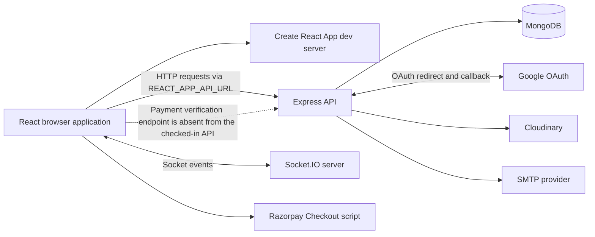
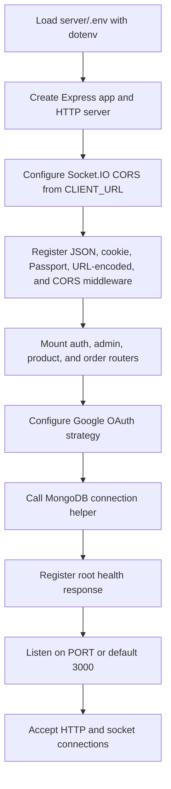
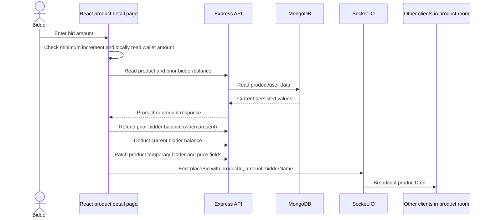
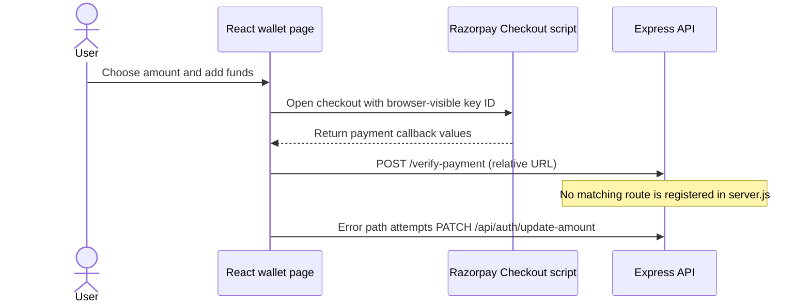
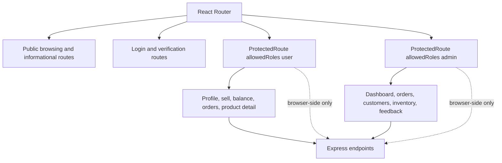

# AuctionX — Project Guide and Source Review

_Transforming Auctions Into Limitless Opportunities_


## Frontend Technologies


## Backend Technologies


---

## Table of Contents

- [Overview](#overview)
- [Getting Started](#getting-started)
- [Prerequisites](#prerequisites)
- [Installation](#installation)
- [Usage](#usage)
- [Testing](#testing)

---

_A source-based guide to the AuctionX localhost auction application._

> **Read this first — important security and reliability warnings**
>
> This repository looks like a student/demo project and is **not safe to expose to the public internet or use for real money or personal data without substantial security work**. The source review found critical-looking issues: the password-reset endpoint can change a user's password after checking only their email (the route does not require proof of the OTP); wallet balances and bids can be changed through unauthenticated API routes; product/order/admin data routes are largely unprotected; and the live Socket.IO bid event trusts values sent by the browser. The payment UI also has no matching server-side Razorpay verification endpoint in the registered backend routes, and its error path can credit a balance locally/server-side. Treat all money, bid, identity, and admin data as untrusted until these paths are secured.
>
> **Local run caveat:** the backend defaults to port `3000`, which is also Create React App's usual frontend port. Set the backend `PORT=5000` (or another free port) and configure the frontend API URL accordingly. The README's older setup text mentions Python/FastAPI and Redis, but neither service is present in this repository's source or manifests.

## What this repository contains

AuctionX is a JavaScript MERN-style web application with a React single-page client and an Express/Mongoose server. It includes auction listings and a bidding interface, account flows, seller and admin screens, feedback/contact pages, and a wallet/payment interface. MongoDB is the main persistent store. Socket.IO is used for live bid display; Cloudinary and SMTP credentials are expected for image and email features; Google OAuth credentials are expected for Google sign-in.

This guide describes what the checked-in source appears to implement. It is not a claim that every flow is working or secure. No Python recommendation service, Redis service, or separate AI service appears in the repository inventory or package manifests.

## Feature inventory

### Public and visitor-facing pages

- Home page, category/product browsing, search, product details, today/tomorrow auction views, and not-found handling.
- About, contact, FAQ, shipping, payment information, privacy, security, terms, and feedback pages.
- Product imagery, banners, share controls, loading states, and responsive UI components.

### Accounts and profiles

- Email/password registration and login, Google OAuth sign-in, logout, profile completion/verification, and profile editing.
- OTP send/resend/verification UI and password recovery/reset screens.
- User profile page, profile image, and a client-side protected-route wrapper for user/admin sections.

### Auctions and sellers

- Create a product listing with category, description, images, and bidding schedule; edit/delete seller listings subject to a one-hour timing restriction.
- Browse product listings and seller history; view an auction countdown and place a bid from the product detail UI.
- Socket.IO product rooms broadcast a current bid/bidder display to connected clients.
- Auction completion code attempts to create an order summary and update/close or remove the listing.

### Wallet, orders, and admin UI

- Wallet balance display and add-funds page with Razorpay Checkout UI and several payment method graphics.
- Order history/detail and downloadable invoice UI.
- Admin dashboard, revenue chart/cards, inventory, customer, order, and feedback pages.
- Feedback/contact submission and email utilities.

**Implementation caveat:** a visible page or client flow does not establish that its backend authorization, business rules, payment settlement, or end-to-end behavior is complete. In particular, frontend route guards are not a substitute for server authorization.

## Important security and correctness findings

These are observations from static inspection of the checked-in code, not results of a penetration test.

| Priority | Finding                                                                                                                                                                                                       | Why it matters                                                                                                                                                 |
| -------- | ------------------------------------------------------------------------------------------------------------------------------------------------------------------------------------------------------------- | -------------------------------------------------------------------------------------------------------------------------------------------------------------- |
| Critical | `PATCH /api/auth/update-password` runs `checkUserByEmail` and then updates the password. It does not require a verified reset token/OTP or an authenticated session.                                          | Knowing a registered email may be enough to take over that account. The UI's OTP flow does not secure this API route.                                          |
| Critical | Wallet balance read/update handlers are reachable at `/api/auth/get-amount` and `/api/auth/update-amount` without authentication in the route declarations.                                                   | A caller can potentially inspect or set another user's balance by email. Bidding relies on these client-triggered balance changes.                             |
| Critical | Product mutation, bid-data patch, successful-auction deletion, image deletion, and order create/read routes are declared without authentication/ownership checks.                                             | Callers may alter listings, bid fields, orders, or images and read data outside the intended UI.                                                               |
| Critical | Admin-facing user/customer/feedback/revenue routes are not consistently protected with the `isAdmin` middleware. Some user deletion screens may be guarded only in the client.                                | Direct API callers can bypass the admin UI and may access or alter administrative data.                                                                        |
| Critical | The Socket.IO `placeBid` handler accepts `productId`, `currentBid`, and `bidderName` directly from the client and broadcasts them without server-side identity, amount, timing, balance, or atomicity checks. | Forged bids and inconsistent auction state are possible; in-memory Socket.IO state is not durable or authoritative.                                            |
| Critical | The payment UI posts to `/verify-payment`, but no such route is registered in `server.js`. Its verification error handler adds the amount to the displayed/server wallet.                                     | Payment success is not securely established by this implementation; wallet credit must never be based on client-controlled callbacks or verification failure.  |
| High     | Google OAuth callback places the JWT and profile data in URL query parameters, and the backend logs the token.                                                                                                | URLs and logs can be retained or exposed through browser history, server logs, analytics, and referrer handling.                                               |
| High     | Auth controllers log request bodies, password hashes, tokens, and/or password-related values.                                                                                                                 | Logs may capture credentials or authentication material and should be treated as sensitive.                                                                    |
| High     | Auth cookies are configured with `secure: false`; JWTs are also returned in response bodies and stored client-side by parts of the app.                                                                       | Production traffic should use HTTPS and secure, HttpOnly, appropriately SameSite cookies; avoid exposing bearer tokens to browser script storage.              |
| High     | Several controllers appear to accept identity fields such as email from request parameters/body for profile and balance operations without binding them to the authenticated principal.                       | IDOR/account impersonation risks remain even where a client screen requires login.                                                                             |
| High     | JWT middleware expects different claim names (`decoded.id`, `decoded.userId`, and role/email claims); the OAuth token is shaped differently from password-login tokens.                                       | Authorization can fail open/closed inconsistently, and admin/user identity checks may not behave as intended. Review token creation and verification together. |
| Medium   | OTP retrieval is exposed through `GET /api/auth/get-otp/:email`.                                                                                                                                              | OTPs should not be retrievable by unauthenticated email lookup; use short-lived, one-time server-side verification and rate limits.                            |
| Medium   | No rate limiting, request-size policy, schema validation strategy, or security headers are evident in the main Express setup.                                                                                 | Authentication, OTP, contact, and upload-related endpoints are exposed to abuse and malformed input.                                                           |
| Medium   | Bid state is held in a process-local object in `server.js`, while other bid fields are written separately to MongoDB from the client.                                                                         | Restarting the process loses socket state; multiple server instances do not share it; competing updates can race.                                              |

Do not use production credentials or real user data with the current code. A security review should start by enforcing server-side authentication and authorization on every private route, implementing one-time reset tokens, validating and atomically applying bids/payments on the server, removing sensitive logs, and adding abuse controls.

## Technology and dependency notes

### Client

- React 18, Create React App / `react-scripts` 5, React Router 6.
- Redux Toolkit, React Redux, Redux Persist, Axios, Socket.IO client.
- Bootstrap, React Bootstrap, Ant Design, MDB React UI Kit, styled-components.
- Chart.js, SweetAlert2, React Hot Toast, React Icons / Font Awesome, phone-number input, jsPDF.

### Server

- Node.js, Express 4, MongoDB via Mongoose 8.
- JWT, Passport Google OAuth, bcrypt/bcryptjs, cookie-parser, CORS.
- Socket.IO, Cloudinary, Nodemailer, dotenv, nodemon.

### Maintenance and stale documentation

- `client/package.json` includes a dependency named `boostrap` (misspelled) alongside the real `bootstrap` package. It appears unnecessary and should be checked before dependency cleanup.
- Both `bcrypt` and `bcryptjs` are installed; the auth controller uses `bcryptjs`, while middleware imports `bcrypt`. Confirm whether both are actually needed.
- The lockfiles contain npm deprecation notices in transitive packages, including old glob/rimraf generations and other unsupported utilities. These notices do **not** prove that every direct dependency is deprecated; inspect the current lockfile and dependency tree before upgrading.
- Create React App (`react-scripts` 5) is the build tooling currently declared. Treat it as legacy maintenance tooling and plan a supported build-tool migration separately; do not infer that the application itself is deprecated.
- The original README lists Python 3.8+, FastAPI, and Redis. These are not declared in either package manifest and no corresponding service code was found in the project file inventory, so those prerequisites appear stale or refer to work outside this checkout.
- The root MIT license and `server/package.json` license field (`ISC`) disagree. Clarify the intended licensing before redistribution.

## Repository structure

```text
Auction X/
├── README.md                         # Existing project README (preserved)
├── README_DETAILED.md                # This source-based guide
├── LICENSE
├── client/
│   ├── package.json                  # React app scripts and dependencies
│   ├── public/                       # HTML shell, icons, manifest, robots/sitemap
│   └── src/
│       ├── App.js                    # Route tree
│       ├── pages/                    # User, admin, login, policy/help screens
│       ├── components/               # Shared UI, auction, charts, forms, etc.
│       ├── layouts/                  # User and admin layouts
│       ├── services/ApiEndpoint.js   # Axios API configuration
│       ├── redux/                    # Store and auth slice
│       └── ProtectedRoute/           # Client-side role gate
└── server/
    ├── server.js                     # Express, Passport, Socket.IO and app startup
    ├── package.json                  # API scripts and dependencies
    ├── routes/                       # Auth, product, order, admin route declarations
    ├── controllers/                  # Auth, product, order, admin handlers
    ├── models/                       # Mongoose user, OTP, product, order, feedback
    ├── middleware/                   # JWT/role and auction timing middleware
    └── utlis/                        # DB, Cloudinary, and email helpers (folder spelling as checked in)
```

The frontend is organized by pages/components/layouts and the backend by routes/controllers/models/middleware. Filenames and folder spelling above reflect the current repository.

## Prerequisites

- Node.js and npm compatible with the installed React and server packages. The project does not declare an engines version; use a currently supported Node LTS and resolve any compatibility issues before deployment.
- MongoDB (local or hosted) and a connection string.
- Google OAuth client credentials if Google sign-in is to be used.
- Cloudinary credentials for server-side image operations.
- SMTP credentials for email/OTP/contact mail utilities.
- Razorpay key for the client payment widget; this key is public by design when prefixed `REACT_APP_`. Never put Razorpay secrets in the React environment. The current server does not implement payment verification.

Python and Redis are not required by the code present in this checkout.

## Local setup

Open two terminals from the repository root.

### 1. Configure the backend

Create `server/.env` with values appropriate for your local environment:

```dotenv
PORT=5000
CLIENT_URL=http://localhost:3000
MONGODB_URL=mongodb://127.0.0.1:27017/auctionx
JWT_SECRETE=replace-with-a-long-random-development-secret
GOOGLE_CLIENT_ID=your-google-oauth-client-id
GOOGLE_CLIENT_SECRET=your-google-oauth-client-secret
EMAIL_USER=your-smtp-account
EMAIL_PASS=your-smtp-app-password
CLOUDINARY_CLOUD_NAME=your-cloud-name
CLOUDINARY_API_KEY=your-cloudinary-key
CLOUDINARY_API_SECRET=your-cloudinary-secret
```

`JWT_SECRETE` is misspelled in the source and must match that spelling unless the source is changed. Keep `.env` out of version control and never reuse development secrets in production. Google OAuth redirect/callback configuration must match the server's `/auth/google/callback` route and the deployed backend host.

Then install and start the API:

```bash
cd server
npm install
npm start
```

The checked-in server start script uses `nodemon server.js`. With `PORT=5000`, the API health response is available at `http://localhost:5000/`.

### 2. Configure and start the frontend

Create `client/.env`:

```dotenv
REACT_APP_API_URL=http://localhost:5000
REACT_APP_CLIENT_URL=http://localhost:3000
REACT_APP_RAZORPAY_API_KEY=your-public-razorpay-key-id
```

All `REACT_APP_` values are embedded in the browser bundle. Only public configuration belongs here; never place secrets in this file.

In a second terminal:

```bash
cd client
npm install
npm start
```

Create React App normally serves the frontend at `http://localhost:3000`. Keep the server on a different port and ensure `CLIENT_URL` and `REACT_APP_API_URL` agree with the actual URLs. Restart the frontend after changing `.env`.

### Build and test commands

- Client development: `npm start`
- Client production build: `npm run build`
- Client test runner: `npm test` (interactive Create React App runner; no project-specific test inventory was verified here)
- Server: `npm start`
- Server test: `npm test` currently exits with `Error: no test specified`; no backend test suite is configured.

The client build script uses a Unix-style environment assignment (`GENERATE_SOURCEMAP=false ...`). On Windows' default command shell this may fail; use a cross-platform environment-setting approach or adjust the script as a separate code change if needed. The source review did not run builds or tests.

## API surface map

Route declarations are mounted in `server/server.js`; routes below summarize the checked-in handlers. Most of these declarations do not include authorization middleware, which is a security warning rather than an endorsement.

| Prefix          | Examples of current routes                                                                 | Purpose                                     |
| --------------- | ------------------------------------------------------------------------------------------ | ------------------------------------------- |
| `/api/auth`     | register, login, logout, check-user, send/resend/get OTP, update-password, profile, amount | Accounts, verification, profile, and wallet |
| `/api/admin`    | getuser, delete user, total-revenue                                                        | Admin/account reporting                     |
| `/api/products` | create/list/read/update/delete, status, tempdata, image deletion, feedback, contact        | Listings, bid fields, feedback, contact     |
| `/api/admins`   | customers, feedback                                                                        | Admin customer/feedback data                |
| `/api/orders`   | create, list, read by id                                                                   | Auction/order history                       |
| `/auth/google`  | OAuth start and callback                                                                   | Google OAuth handshake                      |
| `/`             | health response                                                                            | Basic server status                         |

The payment UI requests `/verify-payment`, but this endpoint is not registered in the inspected server route setup.

## Data and behavior notes

- MongoDB schemas include users, OTPs, products, orders, and feedback.
- Product images are represented with Cloudinary URLs/public IDs; separate utilities configure Cloudinary.
- Password registration/login uses bcryptjs hashing/comparison. Some other auth middleware imports bcrypt.
- Bid UI checks a minimum increment and local wallet balance in the browser, then makes separate API calls to refund/deduct balances and update the listing. The server does not enforce this transaction as an atomic authenticated operation.
- Socket.IO's product bid data is held in server process memory. MongoDB is also used for selected product fields, so the two state paths can diverge.
- Order creation accepts client-provided auction and contact details; it should derive and validate authoritative values on the server.

## Deployment notes

- Use HTTPS and production-safe cookie settings; configure exact allowed origins rather than broad CORS.
- Set the backend `PORT`, `CLIENT_URL`, and frontend `REACT_APP_API_URL`/`REACT_APP_CLIENT_URL` to the deployed service URLs. The deployed values in the original README are examples and may no longer be live.
- Keep MongoDB, SMTP, Cloudinary, Google OAuth, and payment secrets in the hosting provider's secret store.
- Do not treat successful deployment or a working UI as evidence of secure authorization or payment handling.
- Configure persistence and shared Socket.IO state before scaling beyond one server process.
- Review hosting-specific SPA fallback, OAuth callback URLs, upload limits, logs, backups, and monitoring.

## Project state and review limits

This document was prepared by inspecting the repository's README, client/server package manifests and lockfiles, application routes, and representative controllers/components. It records observed implementation and static risks. It does not prove exploitability in a deployed environment, enumerate every transitive vulnerability advisory, or replace dependency scanning, dynamic testing, or a professional security review. No code was changed as part of this documentation work; the original `README.md` remains the project's original README.

---

## Architecture diagrams

The diagrams below summarize the checked-in architecture. They show current connections and trust boundaries, including points where a flow is not implemented securely. They are not a proposed redesign.

### Repository-level architecture



The browser renders the UI and currently performs several business checks itself. The server owns the MongoDB connection and registers the API and Socket.IO listeners. In the existing bid path, the browser asks the API to mutate balances/product data and separately emits the socket event; there is no single authoritative server transaction tying those operations together.

### Server startup sequence



The database connection helper is invoked during startup, but the source does not show a readiness gate that delays listening until MongoDB is confirmed connected. Treat a successful HTTP listen message as server-process startup, not necessarily proof that database-backed features are ready.

### Current bid flow and trust boundary



**Interpretation:** this records the source's split sequence. The initial amount check is in React; several account and product routes do not enforce authenticated ownership; and the socket listener accepts client-provided values. Concurrent bids, request tampering, failures midway through the sequence, and forged socket payloads can result in inconsistent state. Do not rely on the UI check as a security control.

### Account recovery flow as wired today

```mermaid
flowchart LR
    U[User enters email on recovery screen] --> Check[POST /api/auth/check-user]
    Check --> Send[POST /api/auth/send-otp]
    Send --> Mail[SMTP helper sends OTP]
    Mail --> Verify[OTP UI calls OTP endpoints]
    Verify --> Reset[PATCH /api/auth/update-password]
    Reset --> Middleware[checkUserByEmail loads user by email]
    Middleware --> Save[updatePassword hashes and saves new password]
    Verify -. separate from route authorization .-> Reset
```



The final route declaration protects the update with the email lookup middleware, not proof of OTP completion. That is why this guide treats password recovery as a critical issue even though the UI contains OTP screens.

### Payment UI and missing server confirmation



This diagram is a warning about current code behavior. Do not use this sequence for live payments until an authenticated server-created order and server-verified signature/webhook path are implemented and tested.

### Client route guard relationship



The dotted relationship is intentional: the client route component can hide pages from casual navigation, but it does not add authorization to an API route. Each private backend operation needs its own server-side identity and ownership check.

## Frontend route inventory

Routes below are grouped from `client/src/App.js` and nearby route declarations. A route's presence indicates a screen is wired into the router; it does not guarantee all API actions succeed.

### User-facing and general routes

| Route                 | Screen or purpose                    | Access grouping in the client           |
| --------------------- | ------------------------------------ | --------------------------------------- |
| `/`                   | Home page and discovery              | Public layout                           |
| `/posts/:id`          | Search/detail-style public post view | Public layout                           |
| `/category/:category` | Listings filtered by category        | Public layout                           |
| `/todaybid`           | Today's auction list                 | Public layout                           |
| `/tomorrowbid`        | Upcoming auction list                | Public layout                           |
| `/bid`                | Bid-oriented listing screen          | Public layout in route tree             |
| `/about`              | About page                           | Public layout                           |
| `/about1`             | Additional about page                | Public layout                           |
| `/about2`             | Additional about page                | Public layout                           |
| `/contact`            | Contact page                         | User-protected route in this route tree |
| `/faq`                | Frequently asked questions           | Public layout                           |
| `/privacy`            | Privacy page                         | Public layout                           |
| `/security`           | Security information page            | Public layout                           |
| `/terms`              | Terms and conditions                 | Public layout                           |
| `/whyus`              | Why use AuctionX page                | Public layout                           |
| `/payment`            | Payment information page             | Public layout                           |
| `/report`             | Report suspicious activity page      | Public layout                           |
| `/shipping`           | Shipping information page            | Public layout                           |
| `/feedback`           | Feedback form                        | User-protected route in this route tree |

### Account and verification routes

| Route             | Screen or purpose                   | Notes from route wiring                                              |
| ----------------- | ----------------------------------- | -------------------------------------------------------------------- |
| `/login`          | Login and registration entry        | Also receives Google OAuth callback query values                     |
| `/verifyprofile`  | Complete/verify normal user profile | Calls backend auth endpoints                                         |
| `/verifyGprofile` | Complete/verify Google profile      | Calls backend auth endpoints                                         |
| `/forgetpassword` | Start account recovery              | Uses email and OTP-related API calls                                 |
| `/resetpassword`  | Enter replacement password          | Frontend flow should not be mistaken for server-side OTP enforcement |
| `/OTP`            | OTP entry flow                      | Calls OTP-related endpoints                                          |
| `/OTPverify`      | OTP verification flow               | A distinct verification page exists                                  |

### User-protected routes

| Route                     | Screen or purpose                                  |
| ------------------------- | -------------------------------------------------- |
| `/myprofile`              | User profile, profile details, and account content |
| `/pendingbids`            | Seller's pending/listed item history               |
| `/pendingbids/update/:id` | Edit a seller listing                              |
| `/balance`                | Wallet balance and add-money UI                    |
| `/sell`                   | Create auction listing form                        |
| `/orders`                 | User-facing bid/order history                      |
| `/order/:id`              | Order detail                                       |
| `/contact`                | User contact page                                  |
| `/feedback`               | User feedback form                                 |
| `/product/:id`            | Auction/product detail and bid UI                  |

### Admin-protected routes

| Route                 | Screen or purpose                     |
| --------------------- | ------------------------------------- |
| `/admin`              | Dashboard and charts/cards            |
| `/admin/orders`       | Order list                            |
| `/admin/customers`    | Customer management                   |
| `/admin/inventory`    | Product inventory management          |
| `/admin/feedback`     | Feedback review                       |
| `/admin/feedback/:id` | Feedback detail or selected item view |

### Fallback behavior

- The route tree includes a not-found page at `/pagenotfound`.
- Unknown paths are redirected to `/pagenotfound`.
- Some routes use layouts that control whether a navbar/footer is visible.
- The app uses React Router; direct server hosting must serve the SPA entry point for browser refreshes on nested paths.

## Backend route reference

This table reflects route declarations in `server/routes` and their mount prefixes in `server/server.js`. It intentionally shows declared protection so readers can identify missing middleware. It does not imply that frontend access control is sufficient.

### Authentication and account routes

| Method  | Path                                 | Handler / middleware                 | Declared protection                     |
| ------- | ------------------------------------ | ------------------------------------ | --------------------------------------- |
| `POST`  | `/api/auth/register`                 | `register`                           | None in route declaration               |
| `POST`  | `/api/auth/login`                    | `Login`                              | None in route declaration               |
| `POST`  | `/api/auth/logout`                   | `Logout`                             | None in route declaration               |
| `POST`  | `/api/auth/check-user`               | `checkUserByEmail`, response handler | Email lookup only                       |
| `POST`  | `/api/auth/send-otp`                 | `sendOtp`                            | None in route declaration               |
| `POST`  | `/api/auth/resend-otp`               | `resendOtp`                          | None in route declaration               |
| `GET`   | `/api/auth/checkUser`                | `IsUser`, `CheckUser`                | JWT middleware                          |
| `GET`   | `/api/auth/get-otp/:email`           | `getOtp`                             | None in route declaration               |
| `GET`   | `/api/auth/user/:email`              | `getUserByEmail`                     | None in route declaration               |
| `GET`   | `/api/auth/profile-pic`              | `getProfilePicByEmail`               | None in route declaration               |
| `PATCH` | `/api/auth/updateGProfile`           | `IsGUser`, `updateGProfile`          | JWT middleware                          |
| `PATCH` | `/api/auth/updateProfile`            | `IsUser`, `updateProfile`            | JWT middleware                          |
| `PATCH` | `/api/auth/update-password`          | `checkUserByEmail`, `updatePassword` | Email lookup only; no reset-token check |
| `PATCH` | `/api/auth/updateUserProfile/:email` | `updateUserProfile`                  | None in route declaration               |
| `PATCH` | `/api/auth/verify-user`              | `verifyNormalUser`                   | None in route declaration               |
| `GET`   | `/api/auth/get-amount`               | `getAmount`                          | None in route declaration               |
| `PATCH` | `/api/auth/update-amount`            | `updateAmount`                       | None in route declaration               |

### Product, feedback, and contact routes

| Method   | Path                                     | Purpose                              | Declared middleware                                      |
| -------- | ---------------------------------------- | ------------------------------------ | -------------------------------------------------------- |
| `POST`   | `/api/products/`                         | Create listing                       | None                                                     |
| `GET`    | `/api/products/`                         | List products                        | None                                                     |
| `GET`    | `/api/products/email/:email`             | List products by seller email        | None                                                     |
| `GET`    | `/api/products/:id`                      | Fetch product                        | None                                                     |
| `PUT`    | `/api/products/:id`                      | Update listing                       | `checkTimeRestriction` only; no identity/ownership guard |
| `PATCH`  | `/api/products/statuspatch/:id`          | Change product status                | None                                                     |
| `DELETE` | `/api/products/:id`                      | Delete listing                       | `checkTimeRestriction` only; no identity/ownership guard |
| `DELETE` | `/api/products/deleteSuccessProduct/:id` | Delete completed listing             | None                                                     |
| `DELETE` | `/api/products/delete-image`             | Delete Cloudinary image by public ID | None                                                     |
| `POST`   | `/api/products/submit`                   | Save feedback                        | None                                                     |
| `PATCH`  | `/api/products/tempdata/:id`             | Patch temporary/current bid fields   | None                                                     |
| `POST`   | `/api/products/contact-us`               | Submit contact form/email            | None                                                     |

### Orders and admin routes

| Method   | Path                        | Purpose                   | Declared middleware |
| -------- | --------------------------- | ------------------------- | ------------------- |
| `POST`   | `/api/orders/`              | Create order record       | None                |
| `GET`    | `/api/orders/`              | Read all orders           | None                |
| `GET`    | `/api/orders/:id`           | Read order by ID          | None                |
| `GET`    | `/api/admin/getuser`        | Get users                 | None                |
| `DELETE` | `/api/admin/delet/:id`      | Delete user               | `isAdmin`           |
| `GET`    | `/api/admin/total-revenue`  | Calculate revenue summary | None                |
| `GET`    | `/api/admins/customers`     | Get customer list         | None                |
| `DELETE` | `/api/admins/customers/:id` | Delete customer           | None                |
| `GET`    | `/api/admins/feedback`      | Read feedback             | None                |

The source has two admin-related route groups (`/api/admin` and `/api/admins`) with different protections. Review their intended use and secure every server route consistently.

### OAuth and socket endpoints

| Kind         | Name/path                   | Purpose                                  | Current implementation note                                 |
| ------------ | --------------------------- | ---------------------------------------- | ----------------------------------------------------------- |
| HTTP         | `GET /auth/google`          | Start Google OAuth                       | Requests profile and email scopes                           |
| HTTP         | `GET /auth/google/callback` | OAuth callback                           | Creates or updates user and redirects with query parameters |
| HTTP         | `GET /`                     | Basic health response                    | Returns a server-running message                            |
| Socket event | `joinProductRoom`           | Subscribe socket to a product room       | Accepts a client-supplied product ID                        |
| Socket event | `productData`               | Send current in-memory product bid state | Emitted when the room joins and state exists                |
| Socket event | `placeBid`                  | Update in-memory state and broadcast     | Accepts client-supplied amount/name/product ID              |
| Socket event | `disconnect`                | Log socket disconnect                    | No persistent auction cleanup shown                         |

## Data model orientation

This is a high-level guide to the model files currently in `server/models`. Confirm field definitions in the model source before relying on exact types, defaults, or required-field rules.

### User model

The user schema is defined in `server/models/LoginSchema/user.js`.

- It represents account/profile identity used by email/password login and Google OAuth.
- It includes a password field with conditional required logic for non-new OAuth users.
- It includes profile details and role/verification-related state used by UI and middleware.
- The OAuth callback stores a profile photo URL and sets a user role for new OAuth accounts.
- A profile schema field and a JWT claim are not automatically consistent: code paths must agree on claim names and principal IDs.
- Public API responses should select only safe profile data; controllers must not return password hashes or OTPs.

### OTP model

The OTP schema is defined in `server/models/LoginSchema/otp.js`.

- It backs one-time-code email workflows in the auth controller.
- An OTP record should have explicit expiry, one-time consumption, attempt limits, and account binding.
- The route-level OTP lookup currently exposes a retrieval path by email; this guide flags that route as unsafe.
- A reset should be authorized by a short-lived proof produced only after successful OTP verification, not by the email address alone.

### Product model

The product schema is defined in `server/models/SellAnItemSchema/Product.js`.

- It stores auction listing content and seller-associated fields.
- Product fields include details used by listing pages, image URLs/Cloudinary IDs, and bidding schedule/price/status data.
- Temporary bidder-related fields are patched by the bidding UI through `tempdata`.
- Seller ownership needs server-side checks against the verified principal for edit/delete operations.
- Price, bid, and status fields must be validated server-side; the browser must not be authoritative.

### Order model

The order schema is defined in `server/models/SellAnItemSchema/orderSchema.js`.

- It stores an auction completion/order snapshot such as product title, winner/user, seller, category, images, bid values, and contact/delivery details.
- The create-order controller accepts these values from the request body.
- A trusted server should derive the winner and final price from authoritative auction state rather than trusting submitted fields.
- Read-by-ID and read-all routes should filter data by the authorized user or admin role.

### Feedback model

The feedback schema is defined in `server/models/SellAnItemSchema/feedbackSchema.js`.

- It stores submitted feedback/contact-like user details.
- Public submission endpoints need input validation and abuse throttling.
- The admin read endpoint needs server-side admin authorization.
- Avoid returning internal metadata or personal data to unauthorized callers.

## Feature behavior: implementation detail

### Browsing and discovery

1. The home page composes banners, product lists, category components, and navigation.
2. Product and category components request data from `REACT_APP_API_URL`.
3. Search components use fetched product data to match listings in the browser.
4. Product detail screens load a product by ID and render listing description, images, seller information, price, and a countdown.
5. Today/tomorrow components present listings based on date/time data.
6. Most listing retrieval endpoints are public in the route declarations.
7. Pagination and query-level search are not established by the route inventory inspected here.
8. Product validation and safe image constraints should be enforced at the API boundary.

### Seller listing creation

1. The user navigates to the sell page through the user route grouping.
2. The form gathers product identity, description, category, phone/contact fields, bid starting price, and schedule fields.
3. The client may upload or prepare image values for the listing.
4. The client sends a request to `POST /api/products`.
5. The server creates a Mongoose product from the submitted request body.
6. The current create route does not show token/ownership middleware.
7. The API should whitelist fields rather than persist arbitrary client fields.
8. Production hardening should validate required values, numeric ranges, time zones, image count/size, and seller identity.

### Seller listing update and delete

1. Seller history loads products matching an email address.
2. The edit screen reads listing data and submits changed fields.
3. The update route invokes `checkTimeRestriction` and then the controller's time-window logic.
4. The controller prevents changes to the initial bidding date/time after submission.
5. The controller attempts to remove images removed from the listing from Cloudinary.
6. It updates a subset of product fields and saves the document.
7. The delete route also invokes time restriction and removes Cloudinary images before deleting the document.
8. These checks concern timing, not user ownership; the route does not prove that the caller owns the listing.
9. Cloudinary deletion and database changes are separate operations; failures can leave orphaned images or partial state.

### Bid submission

1. Product detail loads listing and amount data.
2. The component connects to the Socket.IO server and joins a product room.
3. The UI computes a local minimum bid increment (the current component uses a ₹200 increment).
4. The UI compares the submitted value with a balance fetched by email.
5. For a previous bidder, the UI requests balance information and attempts a refund.
6. The UI deducts the new bidder amount by calling the wallet update API.
7. The UI patches temporary bidder/amount data on the product.
8. The UI emits `placeBid` with product ID, amount, and display name.
9. The server broadcasts the socket payload to clients in the room.
10. The order/end-of-auction code attempts to create an order and close or delete the product.
11. These are separate requests, not an atomic transaction.
12. Client-side validation can be bypassed by direct HTTP/socket clients.
13. The route/controller and socket event should be refactored to accept a single authenticated bid command and validate it against database state atomically.

### Auction timing

- A product stores a start date/time and end time that the UI uses to display countdown state.
- The UI assembles date and time values and calculates remaining time in the browser.
- The server has timing middleware used for seller update/delete restrictions.
- A countdown display does not prevent requests after auction end; all eligibility/time checks must be repeated on the server.
- Time-zone interpretation must be consistent between stored values, server parsing, browser display, and deployment environment.
- Race conditions near the auction end need a defined server-side cutoff rule.

### Account registration and login

1. The login page switches between account creation and login forms.
2. Registration submits name, email, and password to `/api/auth/register`.
3. The controller hashes the password with bcryptjs and persists a user.
4. The controller creates a JWT and sets a cookie, and also returns a token in JSON.
5. Login looks up a user by email and compares the submitted password with its hash.
6. On successful login, a JWT is created and returned with basic user information.
7. Registration/login controllers log request or account information in places; remove sensitive values before any public deployment.
8. The UI also persists some identity values in browser storage; treat them as display hints, not authorization claims.
9. Server routes must check a token and reload/validate role and account status for protected actions.

### Google OAuth

1. The browser navigates to the server's `/auth/google` route.
2. Passport requests the user's Google profile and email.
3. The callback looks up the account by email.
4. Existing accounts have profile photo data updated; new accounts are created with a role and `isNewUser` state.
5. The server signs a JWT.
6. The callback redirects to the configured client URL with token and profile values in the query string.
7. The client login route consumes those values to continue the UI flow.
8. Query-string tokens are a material exposure risk; use a safer callback/session exchange pattern.
9. Validate OAuth state, redirect configuration, account linking policy, and verified email behavior before production use.

### OTP and password recovery

1. A user supplies an email to the recovery screen.
2. The client checks whether the account exists and requests an OTP.
3. The server stores/sends a code via the SMTP utility.
4. The client has routes to enter and verify an OTP and to request another code.
5. The client submits a new password through the update-password route.
6. The current route associates the request to a user by email only.
7. The server hashes and saves the supplied new password.
8. Because the final write is not gated by OTP proof, the UI sequence does not provide sufficient protection.
9. Do not expose OTP values through a GET endpoint.
10. A robust reset flow would issue a random one-time token only after OTP verification, store only a hash, enforce a short expiry, limit attempts, consume once, and invalidate sessions as appropriate.

### Wallet and payment interface

- The wallet screen reads a balance by the email in browser storage.
- The page loads Razorpay Checkout from its hosted script.
- The page passes a client-visible Razorpay key ID and amount to the checkout widget.
- The selected amount has a client-side minimum threshold.
- The payment handler sends values to a relative `/verify-payment` URL.
- The server route inventory contains no payment-verification endpoint.
- The handler's error path attempts to increase the wallet balance.
- These observations mean this wallet must be treated as a demonstration UI, not a secure payment implementation.
- A production payment flow must have server-created orders, verified signatures/webhooks, replay protection, authenticated wallet ownership, idempotent ledger entries, and reconciliation.

### Admin dashboard

- The admin layout has navigation/sidebar and page content areas.
- Dashboard components include data cards and charts using Chart.js.
- Inventory components read products and support deletion through product endpoints.
- Customer pages read and delete customer data through admin APIs.
- Orders pages read the order collection.
- Feedback pages load submitted feedback.
- The client route tree wraps admin pages with `ProtectedRoute` and `allowedRoles=["admin"]`.
- The API route declarations do not consistently repeat an admin middleware.
- The total-revenue endpoint computes 30% of the highest bid (or starting price fallback) across stored orders; this is a code-level calculation, not proof of actual collected revenue.
- Access to admin data must be enforced on every server route regardless of how the client route is wrapped.

### Feedback and contact

- The feedback UI submits user-entered details to `/api/products/submit`.
- The contact page sends a request to `/api/products/contact-us`.
- The contact utility uses configured SMTP credentials to send mail.
- Both routes are public in the route declaration.
- Validate text length, email/phone shape, and allowable fields before saving or emailing.
- Add rate limits and bot controls to reduce abuse.
- Escape or safely render submitted text in admin views.
- Avoid logging message bodies or personal details unnecessarily.

### Invoice and order history

- User pages request order collections and individual order records.
- The invoice component uses jsPDF in the browser to construct a downloadable document.
- Client-generated invoices are presentation artifacts and should be compared with server-authoritative order data.
- The backend order endpoint currently returns all orders for the collection route.
- Users should only receive their own orders; administrators may receive a broader view after server role verification.
- Contact/address information in orders is sensitive personal data and should not be globally readable.

## Environment variable reference

This table records environment variable names referenced by inspected code or setup documentation. A variable existing in code does not mean the associated feature is complete.

| Variable                     | Read by                         | Exposure                  | Notes                                                                        |
| ---------------------------- | ------------------------------- | ------------------------- | ---------------------------------------------------------------------------- |
| `PORT`                       | `server/server.js`              | Server-only               | Defaults to 3000 in source; choose a free backend port such as 5000 locally. |
| `CLIENT_URL`                 | CORS, Socket.IO, OAuth redirect | Server-only               | Must match the actual frontend origin exactly.                               |
| `MONGODB_URL`                | DB helper                       | Server-only secret/config | MongoDB connection URI; protect credentials embedded in hosted URIs.         |
| `JWT_SECRETE`                | JWT signing/verification        | Server-only secret        | Source spelling includes the final `E`; keep consistent with current code.   |
| `GOOGLE_CLIENT_ID`           | Passport Google strategy        | Server config             | OAuth client identifier; configure matching callback URL.                    |
| `GOOGLE_CLIENT_SECRET`       | Passport Google strategy        | Server-only secret        | Never expose in the browser bundle.                                          |
| `EMAIL_USER`                 | Nodemailer utilities            | Server-only account       | SMTP sender/login account.                                                   |
| `EMAIL_PASS`                 | Nodemailer utilities            | Server-only secret        | Use a provider app password or managed SMTP credential.                      |
| `CLOUDINARY_CLOUD_NAME`      | Cloudinary utilities            | Server config             | Cloud account identifier.                                                    |
| `CLOUDINARY_API_KEY`         | Cloudinary utilities            | Server config             | Treat according to provider guidance; do not expose admin credentials.       |
| `CLOUDINARY_API_SECRET`      | Cloudinary utilities            | Server-only secret        | Never expose in client environment.                                          |
| `REACT_APP_API_URL`          | Axios/API calls and socket URL  | Public browser bundle     | Base URL for backend; values are visible to users after build.               |
| `REACT_APP_CLIENT_URL`       | Client metadata/navigation      | Public browser bundle     | Frontend's public origin.                                                    |
| `REACT_APP_RAZORPAY_API_KEY` | Wallet checkout page            | Public browser bundle     | A public key ID is expected; never place a payment secret here.              |

Only the names above were observed/referenced. This is not a guarantee that all optional runtime variables have been discovered or validated at startup.

## Repository file map: server

### Application entry point

- `server/server.js` creates the Express app and HTTP server.
- It configures Socket.IO with an origin based on `CLIENT_URL`.
- It sets DNS servers to public Google DNS addresses.
- It calls the MongoDB connection helper.
- It configures JSON, cookies, Passport initialization, URL-encoded parsing, and CORS.
- It mounts auth, admin, products, and orders routers.
- It defines the Passport Google strategy and OAuth endpoints.
- It registers the root health endpoint.
- It keeps product bid state in a JavaScript object in process memory.
- It listens on `process.env.PORT || 3000`.

### Route files

- `server/routes/LoginRoutes/AuthRoutes.js` declares registration, login, OTP, profile, password, verification, and balance endpoints.
- `server/routes/LoginRoutes/AdminLoginRoutes.js` declares user listing/deletion and revenue endpoints.
- `server/routes/SellAnItemRoutes/productRoutes.js` declares product, status, image, feedback, temporary bid, and contact endpoints.
- `server/routes/SellAnItemRoutes/orderRoutes.js` declares order create/list/detail endpoints.
- `server/routes/SellAnItemRoutes/AdminRoutes.js` declares customer and feedback endpoints.
- Authorization middleware is included only on a subset of these route declarations.

### Controller files

- `server/controllers/LoginControllers/AuthController.js` contains most account, profile, OTP, and wallet handlers.
- `server/controllers/LoginControllers/AdminController.js` contains user listing and deletion handlers.
- `server/controllers/SellAnItemControllers/productController.js` handles product CRUD-like operations, feedback, temporary bid fields, status, and image deletion.
- `server/controllers/SellAnItemControllers/orderControllers.js` creates and reads order records.
- `server/controllers/SellAnItemControllers/adminControllers.js` handles customer, feedback, deletion, and revenue operations.
- Controller errors are not uniform: some return generic messages, others include error details or log request data.

### Middleware and utility files

- `server/middleware/LoginMiddleware/verifyToken.js` defines JWT/user/admin-related middleware and password update logic.
- `server/middleware/SellAnItemMiddleware/checkTimeRestriction.js` checks the listing timing restriction for routes that use it.
- `server/middleware/SellAnItemMiddleware/isWithinOneHourOfBidding.js` contains a helper for the one-hour rule.
- `server/utlis/LoginUtils/db.js` connects Mongoose using `MONGODB_URL`.
- `server/utlis/LoginUtils/emailSender.js` sends OTP messages with Nodemailer.
- `server/utlis/LoginUtils/cloudinaryConfiglogin.js` configures Cloudinary for login/profile use.
- `server/utlis/SellAnItemUtils/cloudinaryConfig.js` configures Cloudinary for listing image operations.
- `server/utlis/SellAnItemUtils/ContactUsEmailSender.js` handles contact submission email.
- The folder is spelled `utlis` in the repository; source imports use that spelling.

## Repository file map: client

### Application shell and shared state

- `client/src/index.js` is the React entry point.
- `client/src/App.js` wires the router, layouts, and page routes.
- `client/src/index.css` and `client/src/App.css` provide global/app styles.
- `client/src/Loading.js` provides loading-related UI.
- `client/src/services/ApiEndpoint.js` configures a reusable API client.
- `client/src/redux/Store.js` configures Redux state/persistence.
- `client/src/redux/AuthSlice.js` contains auth-related client state.
- `client/src/ProtectedRoute/ProtectedRoute.js` applies client-side role/navigation checks.

### Page families

- `client/src/pages/User/` contains home, product, sell, search/detail, bidding, profile, payment, seller history, and order/bid history screens.
- `client/src/pages/Login/` contains login, profile verification, OTP, forgotten password, and reset-password screens.
- `client/src/pages/Admin/` contains dashboard, orders, customers, inventory, feedback, and data modules.
- `client/src/pages/Footer/` contains informational, policy, help, and contact screens.
- `client/src/pages/Others/PageNotFound/` contains the fallback page.
- `client/src/layouts/User/` and `client/src/layouts/Admin/` define the two main application shells.

### Shared components

- `client/src/components/Navbar/` and `Footer/` provide common navigation and footer UI.
- `client/src/components/ProductList/`, `ProductList2/`, `ProductDetails/`, `CategoryList/`, and `List/` support catalog display.
- `client/src/components/SearchBar/` contains search and detail-related components.
- `client/src/components/SellAnItemForm/` contains create/update seller listing forms.
- `client/src/components/Banner*/` and `SlideDeisgn/` contain homepage promotional areas.
- `client/src/components/ChatQNA/` contains a local question/answer helper interface.
- `client/src/components/DownloadInvoice/` contains invoice generation UI.
- `client/src/components/AdminDashboard/` contains admin tables, cards, charts, and nested routes.
- `client/src/components/Share/`, `Scroll/`, `ScrollToTop/`, `PreLoader/`, and `List/` provide supporting UI utilities.
- `client/src/assets/images/` contains application illustrations, banners, icons, logos, payment graphics, and profile imagery.

## Dependency and maintenance review detail

### Declared scripts

| Package | Script  | Source-defined behavior                                                          |
| ------- | ------- | -------------------------------------------------------------------------------- |
| Client  | `start` | Runs `react-scripts start`.                                                      |
| Client  | `build` | Runs `GENERATE_SOURCEMAP=false react-scripts build`.                             |
| Client  | `test`  | Runs the Create React App test runner.                                           |
| Client  | `eject` | Exposes Create React App configuration; this is a one-way maintenance operation. |
| Server  | `start` | Runs `nodemon server.js`.                                                        |
| Server  | `test`  | Deliberately exits with `Error: no test specified`.                              |

### Direct dependency observations

- Client `react` and `react-dom` are declared at version range `^18.3.1`.
- Client `react-scripts` is fixed at `5.0.1`.
- Client `react-router-dom` is declared at `^6.26.2`.
- Client Socket.IO client is declared at `^4.8.1`.
- Client uses both Bootstrap and React Bootstrap, plus Ant Design and MDB React UI Kit.
- Client declares both `bootstrap` and the misspelled package `boostrap`.
- Client includes testing-library packages but this document did not run or enumerate test files.
- Server Express is declared at `^4.21.1`; Mongoose at `^8.7.2`.
- Server declares both `bcrypt` and `bcryptjs`; call sites use them in different files.
- Server includes nodemon in regular dependencies rather than a separate development-only section.
- The README technology list includes jsPDF/JWT decode and several UI packages; manifests should remain the authoritative install list.

### Deprecated transitive package notices

The checked-in package lockfiles contain npm `deprecated` metadata for transitive packages. Examples include older glob/rimraf versions and legacy Babel proposal plugins now superseded by standard transforms. A lockfile deprecation notice is different from a security advisory and different from a direct dependency being unmaintained. Before a dependency refresh:

1. Preserve the current lockfiles in version control.
2. Inspect the full direct and transitive dependency tree.
3. Check supported Node versions and framework compatibility.
4. Review security advisories using an up-to-date audit tool.
5. Upgrade in small, reviewable steps.
6. Build and test after each dependency change.
7. Inspect visual regressions in the UI libraries and styling.
8. Do not blindly force major upgrades in the legacy Create React App toolchain.

This document did not run `npm audit`, so it does not claim a definitive list of current CVEs or vulnerable versions.

## Configuration troubleshooting guide

### Frontend shows a network error

- Confirm the backend process is running.
- Confirm `PORT` is set to the port used by the server.
- Confirm `REACT_APP_API_URL` uses the same scheme, host, and port.
- Restart `npm start` after changing client environment variables.
- Inspect the browser developer console for CORS and network errors.
- Confirm `CLIENT_URL` exactly matches the frontend origin.
- Remember Socket.IO also uses the configured origin and API base URL.
- Check MongoDB connection logs if the API responds but database routes fail.

### OAuth returns to the wrong page or fails

- Confirm the Google OAuth client ID/secret are present in the server environment.
- Confirm the provider's authorized redirect URI matches the deployed backend callback URL.
- Confirm the backend `CLIENT_URL` points to the frontend origin.
- Confirm the frontend's `REACT_APP_API_URL` points to the backend.
- Verify that the provider returns an email address because the callback uses the first email entry.
- Do not paste JWT query values into support tickets or public screenshots.
- Clear old OAuth cookies/query strings when testing after configuration changes.

### Email OTP is not delivered

- Confirm `EMAIL_USER` and `EMAIL_PASS` are set in the backend environment.
- Confirm SMTP provider policy permits the configured authentication method.
- Check server output without exposing OTPs or credentials.
- Check spam/quarantine folders and provider sending limits.
- Verify the OTP model and send utility behavior in the exact checkout being run.
- Do not enable an endpoint that returns OTP values as a debugging workaround.

### Images fail to upload, display, or delete

- Confirm Cloudinary environment values are set server-side.
- Confirm the configured account and resource names are correct.
- Check whether the product record stores valid `secure_url` and `public_id` values.
- Distinguish a browser image-load issue from an API deletion issue.
- Do not expose `CLOUDINARY_API_SECRET` in the client bundle.
- Consider the partial-failure case where Cloudinary deletion succeeds but MongoDB update fails, or vice versa.

### Port already in use

- CRA normally uses port 3000 for the browser app.
- The server's source default is also 3000.
- Set a distinct backend port in `server/.env`.
- Update the frontend API URL and server's CORS origin.
- Check for an existing server process before changing a port arbitrarily.

## Local manual review checklist

This is a manual verification outline for maintainers. It is not evidence that these checks have been run for this README update.

### Startup checks

- [ ] Client and server dependencies install from their own package directories.
- [ ] Server starts on a port separate from the CRA client port.
- [ ] MongoDB connection succeeds with the configured URI.
- [ ] Client opens and can reach the API root health endpoint.
- [ ] CORS allows the intended local client origin.
- [ ] Socket.IO connection succeeds from the client.
- [ ] The browser console contains no configuration secrets.
- [ ] The server log contains no raw password, OTP, or JWT values.

### Visitor browsing checks

- [ ] Home page loads without authentication.
- [ ] Category list loads product data.
- [ ] Search returns relevant listing results.
- [ ] Product detail loads by product ID.
- [ ] Product images have valid URLs and meaningful alternative text.
- [ ] Today/tomorrow screens handle empty result sets.
- [ ] Countdown UI handles missing or invalid schedule values.
- [ ] Unknown client paths show the not-found screen.

### Account checks

- [ ] Registration rejects missing required data.
- [ ] Duplicate email behavior is understandable to the user.
- [ ] Passwords are never stored as plain text.
- [ ] Login rejects incorrect credentials.
- [ ] Logout clears the active auth state/cookie as intended.
- [ ] Google OAuth returns to the expected origin.
- [ ] Google OAuth account linking handles an existing email safely.
- [ ] Profile edits affect only the authenticated user's own account.
- [ ] Role changes cannot be made by modifying client data.
- [ ] OTP requests are rate limited and errors do not reveal sensitive account state.
- [ ] OTPs expire and can only be consumed once.
- [ ] Password reset cannot be completed using only a known email address.

### Listing checks

- [ ] Seller can create a listing with valid fields.
- [ ] Invalid prices, schedules, and oversized text are rejected server-side.
- [ ] Listing images are validated and associated with the correct product.
- [ ] Seller cannot create a listing attributed to another account.
- [ ] Seller can update only their own listing.
- [ ] Seller can delete only their own listing.
- [ ] Timing restrictions are enforced by the server.
- [ ] Status changes are authorized and validated on the server.
- [ ] Image deletion cannot target another user's Cloudinary asset.
- [ ] Product read APIs return only intended fields.

### Auction and bid checks

- [ ] Bid start and end boundaries are checked on the server.
- [ ] Bid increments are checked on the server.
- [ ] Bidder identity is derived from authentication, not browser storage.
- [ ] A user cannot outbid with an insufficient balance.
- [ ] Balance deduction and bid persistence are atomic/idempotent.
- [ ] Prior bidder refund is correct and cannot be replayed.
- [ ] Two simultaneous bids have deterministic ordering.
- [ ] Socket events cannot broadcast fabricated bidder identities or amounts.
- [ ] Refreshing or reconnecting shows authoritative persisted auction state.
- [ ] Multiple backend instances share live auction state or use a durable event adapter.
- [ ] Auction close/winner selection happens once.
- [ ] Order creation and product close cannot be duplicated by retries.

### Payment and wallet checks

- [ ] No wallet balance can be changed by an unauthenticated request.
- [ ] A user cannot change another user's wallet by changing an email parameter.
- [ ] Server creates payment orders with a fixed authenticated customer.
- [ ] Server verifies payment signatures and trusted provider webhooks.
- [ ] Invalid, replayed, or duplicate payment callbacks never credit funds.
- [ ] A network failure never credits funds without provider verification.
- [ ] The amount credited matches the server-created order amount.
- [ ] Wallet ledger entries are immutable and reconcilable.
- [ ] Payment secrets are never sent to the browser.
- [ ] Refund and chargeback behavior is documented and handled.

### Admin and order checks

- [ ] Every admin API checks an authenticated admin principal server-side.
- [ ] Non-admin users cannot query user/customer lists directly.
- [ ] Non-admin users cannot delete users or listings directly.
- [ ] Users can read only their own order data.
- [ ] Order snapshots derive winner/price from authoritative records.
- [ ] Feedback details are visible only to authorized staff.
- [ ] Revenue calculations match a documented business rule.
- [ ] Admin deletion actions are auditable and confirm the intended target.

### Deployment checks

- [ ] Production uses HTTPS throughout.
- [ ] Cookie flags are suitable for the deployment topology.
- [ ] CORS allowlist contains only intended client origins.
- [ ] Secrets are set in hosting configuration, not committed files.
- [ ] The SPA host has a fallback for nested routes.
- [ ] OAuth callback URLs match provider configuration.
- [ ] MongoDB uses least-privilege credentials and backups.
- [ ] Logging excludes passwords, tokens, OTPs, and payment data.
- [ ] Rate limits protect login, OTP, contact, and mutation endpoints.
- [ ] Error responses do not disclose stack traces or internal database details.
- [ ] Security headers and request body limits are configured.
- [ ] Dependency advisories are checked with current tooling.
- [ ] Build output and static assets are reviewed before release.

## Known gaps and non-goals of this guide

- This file does not replace the original `README.md`; it is an expanded companion.
- It does not claim every UI component has been exhaustively exercised in a browser.
- It does not claim that all source files are bug-free or that every route has been analyzed for every attack class.
- It does not include actual production secrets, personal records, or copied `.env` values.
- It does not claim Python, FastAPI, Redis, or AI recommendations are implemented in this checkout.
- It does not assert that an API route is exploitable in every deployment; it records missing protection in the inspected route declaration/handler path.
- It does not identify current CVEs because no dependency audit was run as part of writing this documentation.
- It does not change authentication, authorization, payment, bidding, dependency, or deployment code.
- It does not treat the README feature list as proof that each feature is secure or complete.

## Suggested reading order for maintainers

1. Read the warning block at the top of this file.
2. Read `client/src/App.js` to understand the visible route tree.
3. Read `server/server.js` for middleware, route mounts, OAuth, and socket startup.
4. Read `server/routes/LoginRoutes/AuthRoutes.js` and the other route files to understand API exposure.
5. Read the matching controller for each route before trusting its behavior.
6. Compare the JWT claims created by every login flow with `verifyToken.js` expectations.
7. Trace one user workflow from the React page through API call, route, controller, model, and response.
8. Review every route handling identity, money, permissions, personal data, or destructive actions.
9. Treat package-lock deprecation notices separately from security audit results.
10. Update this companion README whenever the implemented routes, environment variables, or runtime architecture changes.

## Change log for this companion document

| Revision               | Description                                                                                                                                                                |
| ---------------------- | -------------------------------------------------------------------------------------------------------------------------------------------------------------------------- |
| Initial detailed guide | Added project overview, setup, repository map, API overview, dependency notes, and static security observations based on the current checkout.                             |
| Expanded source guide  | Added architecture and sequence diagrams, route tables, data model orientation, feature behavior, environment reference, file map, troubleshooting, and review checklists. |

## Attribution and relationship to the original README

The existing root `README.md` remains the original project document and has not been replaced by this companion guide. This file expands and corrects context where static inspection of the checked-in source differs from older README claims. In particular, setup prerequisites and feature descriptions above are tied to the files and manifests currently present in this repository. Re-check the source when the project changes, and keep both documents consistent where the original README is later intentionally updated.
